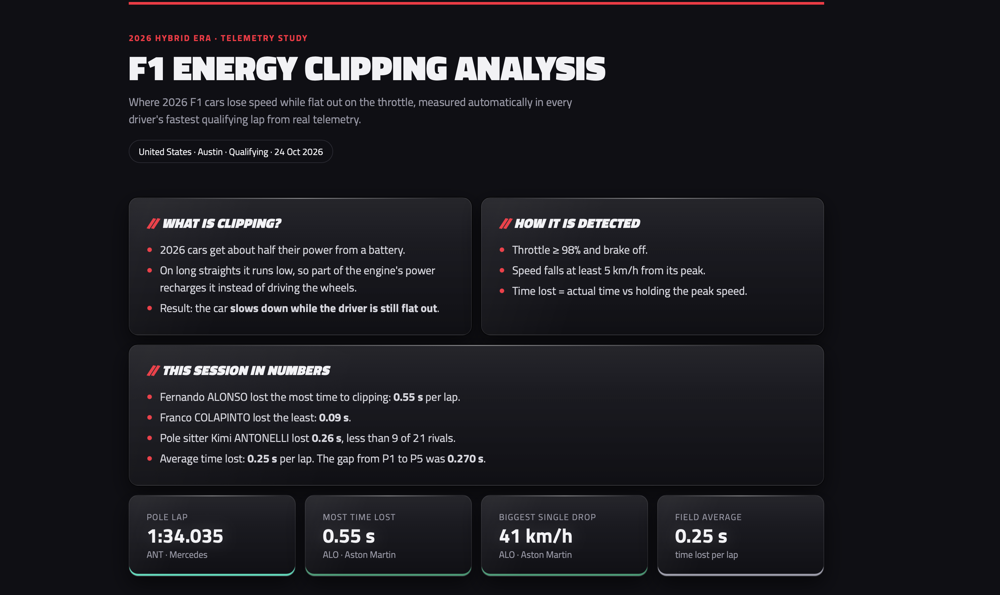
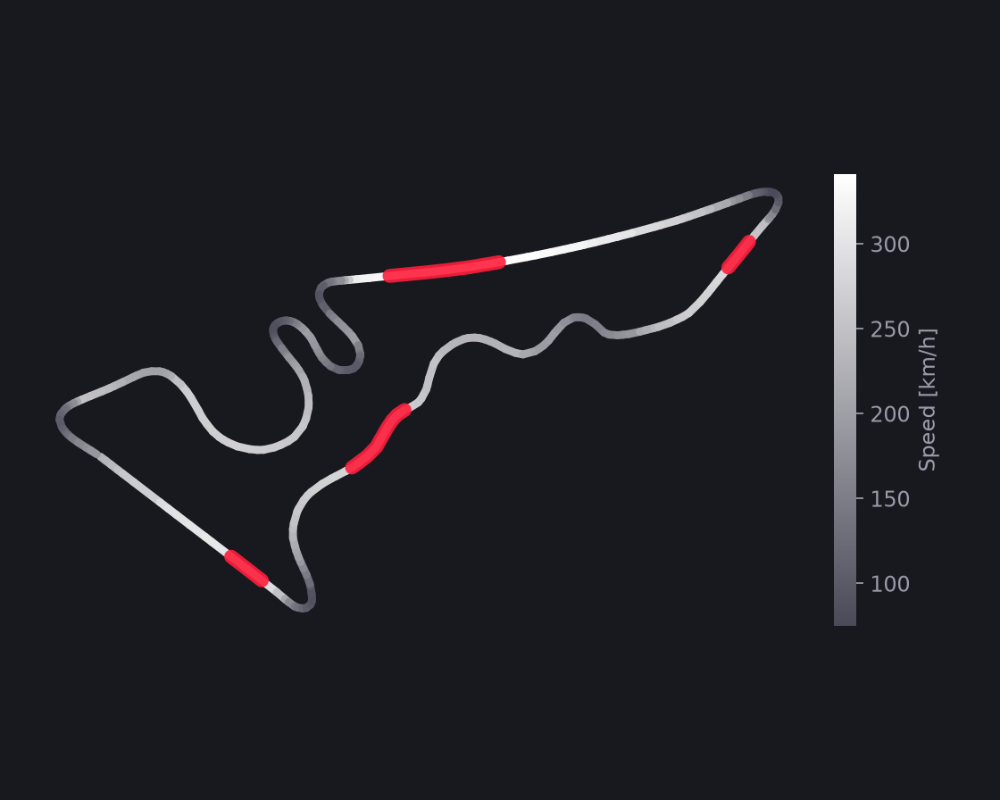
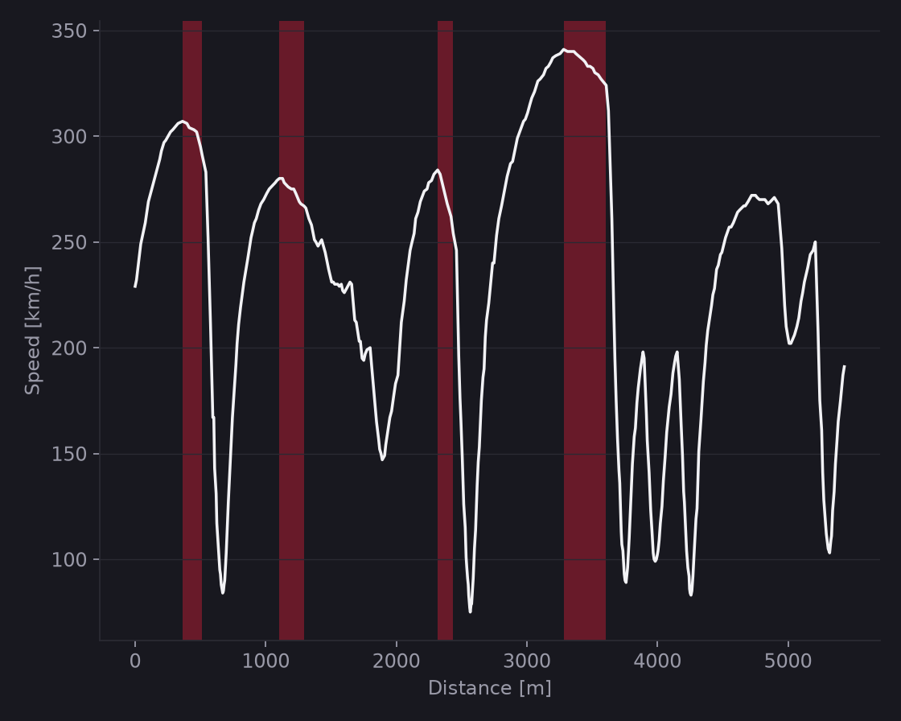
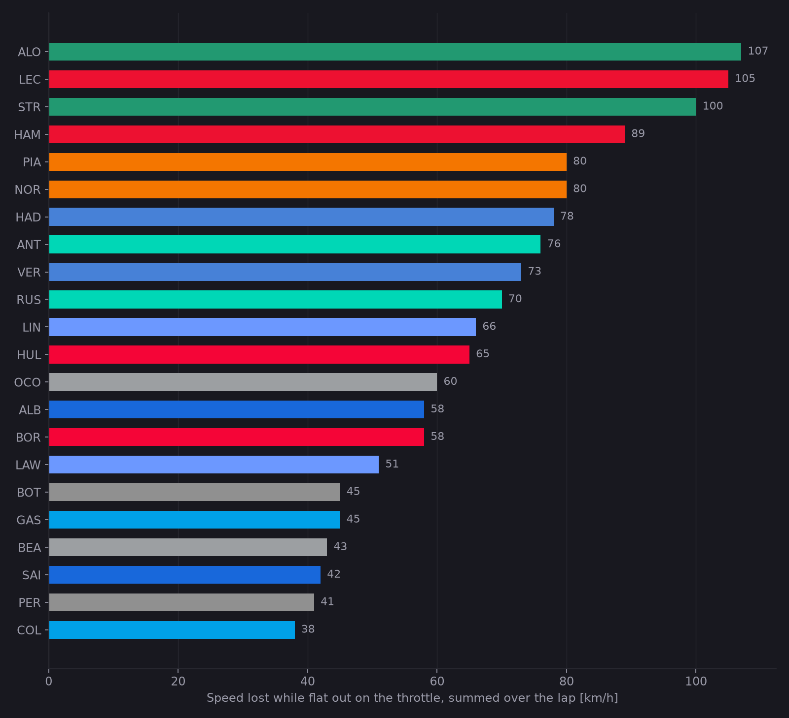

# F1 Energy Clipping Analysis


**Full throttle. Losing speed. Why?**

In 2026 about half of an F1 car's power comes from a battery. On long straights the battery runs low, part of the engine's power goes into recharging it, and the car **slows down while the driver is still flat out**. This is called *super clipping*.

This project finds it automatically in real telemetry, for every driver, and publishes the results after each race weekend.

### 👉 [Live results](https://jabolos10.github.io/F1_Energy_Clipping_Analysis/)



---

## Key findings: 2026 United States GP, qualifying

| | |
|---|---|
| **0.25 s per lap** | average time lost to clipping across the grid |
| **0.270 s** | the whole gap from P1 to P5, about the same as the average clipping loss |
| **0.55 s per lap** | lost by Alonso (Aston Martin), the most in the field |
| **41 km/h** | biggest single speed drop at full throttle |

Clipping costs about as much time as separates the top five. Energy management really is deciding qualifying in 2026.

<p align="center">
  
  
</p>

*Antonelli's pole lap: where on the track the car slowed down at full throttle (red).*



## First finding: Melbourne


On Russell's pole lap in Australia the car peaks at about 327 km/h on the longest straight, then drops to about 280 km/h before the next corner, with the throttle at 100% and the brake never touched.

## How it works

1. Pulls each driver's fastest qualifying lap (speed, throttle, brake, track position) from the [OpenF1](https://openf1.org) API.
2. Finds stretches with throttle ≥ 98% and the brake off.
3. Flags clipping when speed drops at least 5 km/h from its peak, then estimates the time lost against holding that peak speed.
4. Builds a results page: track map with clipping zones, speed trace, driver ranking, full table and auto-generated findings.

## CI/CD pipeline

```
push / pull request / every Monday
        │
        ▼
  test (Python 3.12 + 3.14): ruff → pytest      tests use synthetic data, no network
        │  only if green, only on main
        ▼
  deploy: latest qualifying from OpenF1 → build site → GitHub Pages
```

## Problems I ran into

- **The data source died mid-project.** In October 2026 the official F1 timing archive started rejecting requests, so FastF1 stopped returning telemetry. I moved the project to OpenF1.
- **OpenF1 locks free access during live sessions** (30 min before to 30 min after). That is why tests run on synthetic data and the scheduled rebuild runs on Monday mornings.
- **Rate limits.** The free tier allows 30 requests per minute, so the client waits between calls and retries when limited.
- **A test that tested nothing.** The linter flagged an unused variable, which turned out to be a test missing its assert. It would always have passed.

## Tech

Python · pandas · matplotlib · OpenF1 API · pytest · ruff · GitHub Actions · GitHub Pages

## Run it locally

```bash
python3 -m venv .venv
source .venv/bin/activate
pip install -r requirements.txt
python -m pytest
python -m scripts.explore      # one lap, three plots
python -m scripts.build_site   # full results site in site/
```

## Features

- Clipping detector with a time-lost estimate for every driver
- Unit tests on synthetic data and CI on every push and pull request
- Results site rebuilt and deployed automatically after every Grand Prix

---

*Data: [OpenF1](https://openf1.org). Unofficial project, not associated with Formula 1 companies.*